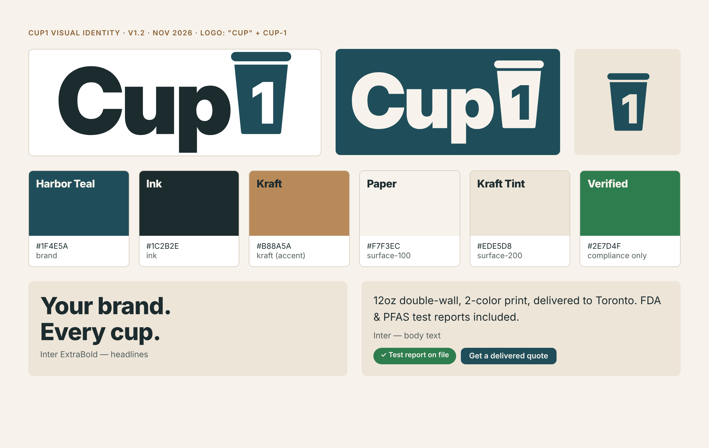

# Brand positioning

**Cup1 is the factory-direct packaging partner that gives North American cafés their own branded cups, with the compliance paperwork already done.**

- **For:** independent café groups, bubble-tea and dessert chains, and regional distributors in the USA and Canada that order 30,000+ cups at a time.
- **Category:** custom-printed food-service packaging, covering cups, lids, bowls and boxes.
- **Why Cup1 wins:** buyers get factory pricing without importing alone. Every order comes with the FDA food-contact and PFAS-free test reports, and Vietnam production keeps duties low.
- **Proof we can show today:** our partner factory's BRC, BPI and FSC certificates, plus the FDA and PFAS test reports requested in the Phase 2 RFQ once they are received and checked. Cup1 has no client case studies yet, so the brand avoids claims like "trusted by hundreds of cafés" until they are true.

The company name stays **Cup1**. It is short and easy to remember, and the tagline does the explaining.

# Visual identity

{width=100%}

- **Logo (v1.2, chosen by the owner):** the name is written as **"Cup"** and the **1 sits inside a teal takeaway cup**, cut out so it shows the background. The cup doubles as the favicon and app icon. Wordmark: Inter Display Black, converted to outlines. Versions: horizontal (primary), reversed, one-color, icon, tile, and a heavier favicon. Rules are in *Cup1_Logo_Guidelines.pdf*. History: round 1 explored three concepts (the C1 Rim Monogram became v1.1); in round 2 the owner chose the "Cup" + cup-1 idea in teal over navy and orange options.
- **Colors:** Harbor Teal `#1F4E5A` (brand), Ink `#1C2B2E`, Kraft `#B88A5A` (accent, never for text), Paper `#F7F3EC` (background), Kraft Tint `#EDE5D8` (cards). Verified green `#2E7D4F` is used **only** for compliance proof. All text colors pass WCAG AA contrast (4.5:1 or better).
- **Type:** Inter (free on Google Fonts). ExtraBold for headlines, Regular and SemiBold for text. The logo wordmark uses Inter Display Black.
- **Imagery:** real product photos from our samples. No stock eco clichés such as leaves, globes or seedlings.
- The full design system (tokens, usage rules, dark theme) lives in the **Cup1 Design System** artifact for the Phase 4 website build.

# Competitor landscape

US competitors split into two camps: "fast and low-minimum" or "sustainable but slow". None of them leads with compliance paperwork plus factory pricing, and that is the gap Cup1 takes.

| Brand | Lead message | Minimum | Price / lead time seen | Eco angle |
|---|---|---|---|---|
| YourBrandCafe | "Branding Made Simple", fast turn times, free shipping | 1 case (500 cups) | 12oz DW ≈ $0.38–0.50/cup; ~3 weeks | Compostable range, $1/case to charity: water |
| Good Start Packaging | "Sustainable Materials. Low Minimums. Fast production." | 50 cases (50,000 cups) | 12oz compostable ≈ $0.11/cup; 14–16 weeks | PLA lining, FSC, no added PFAS, B Corp |
| noissue | Custom packaging that's "sustainable & eco-friendly" | Not stated | Not stated | Sustainability is the whole brand |
| LogoCup | Custom cups for any occasion | 50 cups | Event / small-run pricing | Not central |

**Where Cup1 sits:** large-run pricing close to Good Start's, faster production (about 35 days plus shipping), and a full set of compliance documents with every order. Cup1 does not compete on very small orders.

# Target buyers

| | 1. Café group owner | 2. Operations / procurement manager | 3. Packaging distributor |
|---|---|---|---|
| Who | Owner of 3–30 cafés, bubble-tea or dessert shops | Buys supplies for a chain, university or caterer | Regional food-service distributor |
| Wants | Cups that look like *their* brand at a lower cost per cup | Reliable supply, compliant paperwork, one vendor | Private-label stock at factory prices, by the container |
| Fears | Ordering from overseas alone; wrong colors; late delivery | Failing a PFAS or compostable-labeling audit | Quality swings between batches; tariff surprises |
| Cup1 answer | Proofs and samples before paying the balance; delivered price up front | FDA / PFAS / BPI reports on file; reorder schedule | Vietnam-origin production, inspection report each shipment |
| First message | "Your logo on every cup, at factory-direct prices" | "Compliant packaging, documented, delivered" | "Factory-direct private label, lower duty than China" |

The first sales effort goes to buyer 1.

# Messaging

**Value proposition:** Your brand on every cup. Factory-direct prices, with food-safety and PFAS-free paperwork included, delivered to your door in the USA or Canada.

**Three message pillars**

1. **Your brand, everywhere it's carried.** Custom-printed cups, lids, bowls and boxes in one consistent look.
2. **Compliance, documented.** Every order ships with FDA food-contact and PFAS-free test reports. We only call products compostable when they are third-party certified.
3. **Factory-direct, landed.** Large-run pricing from certified factories, quoted as a delivered price with no surprise duties or freight.

**Tagline options** (recommended first)

- **Cup1 — Your brand. Every cup. Fully documented.**
- Cup1 — Branded packaging, done right.
- Cup1 — Factory-direct cups for growing cafés.

**Elevator pitch (20 seconds)**

> Cup1 puts your logo on cups, bowls and takeaway boxes at factory prices. We work directly with certified packaging factories, handle printing, inspection, shipping and customs, and deliver to your door in the US or Canada. Every order comes with food-safety and PFAS-free test reports, so you're covered on compliance.

**Boilerplate**

> Cup1 is a custom food-service packaging company serving cafés, restaurants and distributors across the United States and Canada. Cup1 sources custom-printed cups, bowls and boxes from certified manufacturing partners and manages quality control, logistics and compliance documentation from proof to delivery.

# Brand voice

Cup1 sounds like a reliable operations partner: clear, practical and quietly confident.

| Trait | We say | We avoid |
|---|---|---|
| Clear | "12oz double-wall, 2-color print, delivered to Toronto for $0.17/cup." | "Amazing premium solutions for your brand journey!" |
| Proof-led | "Test report attached." | "100% safe, totally green, planet-friendly." |
| Helpful | "Here's what your artwork needs to print sharply." | Jargon without explanation |
| Steady | "Production takes about 35 days; we'll update you weekly." | Overpromising speed |

Write in American English. Prices are in USD unless the client asks for CAD.

# Claims guardrails

The eco + compliant positioning only works if every claim can be proven. In the US and Canada, a vague green claim is a legal risk.

| Claim | Allowed? | Condition |
|---|---|---|
| "FDA-compliant food-contact materials" | Yes | Only with a current lab test report for that product and supplier |
| "No intentionally added PFAS" | Yes | Supplier declaration + PFAS (total organic fluorine) test report on file |
| "Compostable" | Only if certified | Third-party certified (e.g. BPI); say "commercially compostable – facilities may not exist in your area"; check state labeling rules before printing it on cups |
| "Recyclable" | Avoid | PE-lined cups are not accepted in most curbside programs; California SB 343 limits recyclability claims (enforcement paused by court injunction since 14 Jul 2026) |
| "FSC-certified paper" | Yes | Only when produced under the factory's FSC chain-of-custody |
| "Eco-friendly", "green", "sustainable" with no detail | No | FTC Green Guides treat broad unqualified claims as deceptive; Canada's Competition Act requires substantiation |
| "Trusted by X cafés", reviews, client logos | Not yet | Only with real clients who agree to be named |

**Rule of thumb:** if we can't attach the document, we don't make the claim.

# Product descriptions

The launch range is six products from Sowinpak's catalogue. Bracketed specs must be confirmed against samples before publishing.

**1. Double-Wall Hot Cup — 8 / 12 / 16 oz** *(hero product)*
Two layers of paperboard keep coffee hot and hands comfortable, with no sleeve needed. Printed edge-to-edge with your logo and colors, and paired with snug-fit lids. Food-safe lining, with FDA and PFAS test reports included. Minimum 30,000 cups per design.

**2. Single-Wall Hot Cup — 4 to 20 oz**
The everyday workhorse for espresso, tea and drip coffee. Lightweight and stackable, printed in your brand colors. Add a custom sleeve for extra-hot drinks. [Paper weight: confirm GSM.]

**3. Ripple-Wall Cup — 8 / 12 / 16 oz**
A textured outer wrap gives grip and insulation, with a premium feel in the hand. Ideal for specialty coffee shops that want their cup to stand out.

**4. Ice Cream & Dessert Cups — 3 to 12 oz, with lids**
Sturdy, leak-resistant cups for gelato, frozen yogurt and puddings, printed inside and out. [Freezer performance: confirm with a sample test.]

**5. Kraft Salad & Food Bowls — round and rectangular**
Grease-resistant kraft bowls for salads, poke and hot meals, with matching lids for delivery.

**6. Takeaway Food Boxes — lunch, bakery window and pizza boxes**
Compartment lunch boxes, window boxes for pastries and cakes, and corrugated pizza boxes, all printed with your brand.

# Sample kit concept

The **Cup1 Sample Kit** is the main sales tool. It is sent to qualified prospects after a first call.

- **Box:** kraft mailer (about 30 × 22 × 12 cm) with a one-color Cup1 logo and "Your brand. Every cup." inside the lid
- **Inside:** 8 / 12 / 16 oz double-wall cups, a ripple cup, an ice-cream cup with lid and a kraft bowl, held in a die-cut insert
- **Print card:** a "How we print your logo" guide, a price sheet for 30k / 50k / 100k, and a QR code to the compliance-documents page
- **Personal touch:** where possible, one cup proof-printed with the prospect's own logo
- **Estimated cost:** about $15–25 per kit plus courier (an assumption; get a quote for the mailer boxes with the first sample order)

# Creative brief for Phase 4 (website)

| Item | Brief |
|---|---|
| Goal | Turn café owners and buyers into quote and sample-kit requests |
| Primary action | "Get a delivered quote" form (product, size, quantity, city, logo upload) |
| Secondary action | "Request a sample kit" (qualified leads) |
| Key pages | Home · Products · How it works · Compliance documents · Pricing guide · About · Contact |
| Hero message | "Your brand. Every cup. Fully documented." |
| Look and feel | Cup1 design system: Paper background, Harbor Teal, Inter, real sample photos |
| Must avoid | Unqualified green claims, fake reviews or client logos, stock photos shown as our product |
| Proof elements | Partner factory certificates, sample test reports, a process timeline |

# Sources

- YourBrandCafe – https://www.yourbrandcafe.com/
- Good Start Packaging 12oz compostable cup – https://www.goodstartpackaging.com/12-oz-custom-printed-compostable-white-paper-coffee-cups/
- noissue cups – https://noissue.co/category/cafe-cups-and-sleeves
- LogoCup (Fresh Cup) – https://freshcup.com/with-a-50-cup-minimum-logocup-makes-custom-cups-doable-for-any-occasion/
- California SB 343 injunction (DWT, Jul 2026) – https://www.dwt.com/blogs/energy--environmental-law-blog/2026/07/sb-343-truth-in-recycling-injunction
- Canada Competition Act greenwashing amendments (Mondaq) – https://www.mondaq.com/canada/environmental-law/1768676/legislation-passes-to-amend-environmental-claims-prohibitions-of-the-competition-act
- Green Guides and state compostable claims (Packaging Dive) – https://www.packagingdive.com/news/green-guides-recyclable-compostable-marketing-claims-states/650733
