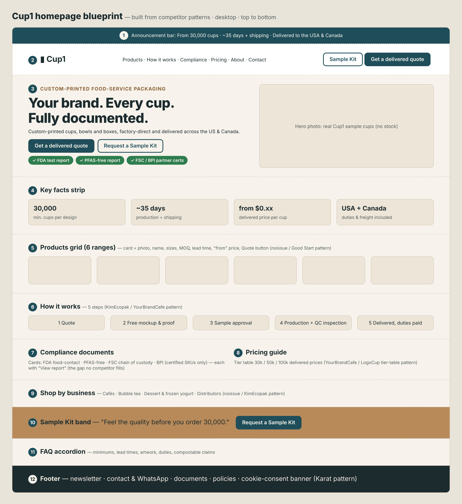

# 1. Summary: the design formula they all follow

Seven competitor sites were inspected live on 5 Nov 2026 (fonts, colors, buttons, page sections, product pages and forms). YourBrandCafe and YOON block automated browsers and were studied from their page content. Despite different looks, the sites follow the same formula:

1. **Lead with the offer, not the company.** The headline states what you get ("Custom Printed Paper Cups USA", "Make a Statement with Branded Cups").
2. **Show minimum order, lead time and price early.** These appear in the page title, hero, product cards or announcement bar (CupPrint "1,000pc MOQ, ready in 15 days"; noissue cards "Min. 1000 units • Delivery: 3 weeks • from $0.10").
3. **Two calls to action:** a buy or quote action plus a low-commitment one (free samples, sample pack, contact).
4. **A persistent "trust strip":** review stars, client logos, certificates, B Corp, "Made in USA", press mentions.
5. **Shop-by-product and shop-by-business navigation:** cafés, bakeries, ice cream and so on.
6. **A "how it works" sequence:** order, proof, production, delivery.
7. **Tier pricing tables** on product pages, where prices drop with quantity.
8. **Proof before production:** free mockups or proofs, design templates, an online designer or logo upload.
9. **Reorder and account features** for repeat buyers.
10. **A heavy footer** with newsletter signup, resources, policies and social links. A cookie-consent banner appears where required.

# 2. Visual design systems compared

| Competitor | Headline font | Body font | Main colors (measured) | Primary button | Personality |
|---|---|---|---|---|---|
| Good Start Packaging | Work Sans 700, UPPERCASE, ~50px | Work Sans 16px | Forest green #335525, teal #007D8A, lime #B7C929, pale grey #F2F4F4 | Green fill, white text, 4px corners | Busy eco store, earthy |
| CupPrint USA | Wix Madefor Display 700, 64px; Fjalla One for section titles | Wix Madefor Text 16px | Purple #6D63A7, pink #DE4569, cream #FFFAF3, yellow #F3D663 | Pink pill (fully rounded), UPPERCASE | Playful, colorful, café-friendly |
| noissue | PP Mori 400, 48px (light, not bold) | PP Mori 16px | Deep purple #2C1847, off-white #FBFBFB, beige #F5F0E8, black | Deep-purple fill, 4px corners | Premium, minimal, editorial |
| LogoCup | Roboto Slab 600, ~65px | Outfit ~21px | Navy #333369, orange #FF6F1A, yellow #FFC522, red-orange #C8452A, cream #F7F1E0 | Yellow/orange, asymmetric "leaf" corners (20px 0) | Bold, fun, events |
| KimEcopak | Jost 42px | Alata ~19px | Navy #021D4B, amber #FFAC26, ochre #CE7D1F, mint-grey #F4F7F6 | Navy pills (19px corners) + amber | Busy, sales-heavy, founder-led |
| Karat Packaging | Montserrat Bold 36px | Helvetica Neue 14px | Navy #091242, black, light grey #F0F0F2, gold #FFB629 | Navy, square corners | Corporate, conservative |
| Sowinpak | Raleway 45px | System font 15px | Dark teal #002D33, green #6AA534/#4A8137, grey | Green, 8px corners and pills | Factory/industrial B2B |
| YourBrandCafe | (not measurable) | (not measurable) | Bright, multi-color e-commerce | "Get Started", "Add to cart" | Friendly small-business |

**Observations**

- **Two camps.** Eco and factory brands use greens and teals (Good Start, Sowinpak). Café-branding brands use warm, playful colors (CupPrint, LogoCup). noissue stands apart with a premium, muted deep purple.
- **Fonts are almost all modern sans-serifs.** LogoCup uses a slab serif for headlines. Big headlines (45–65px) are standard.
- **Buttons:** pills or rounded corners dominate the café-facing brands. Square corners read as corporate (Karat).
- **Photography:** real product-in-use photos of cups and food packaging in cafés and kitchens. LogoCup and CupPrint add illustrated, colorful cup designs to inspire buyers.

**What this means for Cup1:** our Harbor Teal, Paper and Kraft palette with Inter ExtraBold sits between noissue's premium calm and the eco greens. It stays distinct from all competitors, since none uses teal-and-kraft. That keeps the Phase 3 identity valid.

# 3. Homepage anatomy (section order, top to bottom)

| Competitor | Page length | Section sequence |
|---|---|---|
| Good Start | ~6,200px | Free-shipping bar → header with search, free samples, reorder → hero carousel "American-made packaging. Earth-approved." → Shop sustainable packaging (category tiles) → mission "We make it our business to do good" → new products → best sellers → shop by brand → solutions by business type → Instagram gallery → guides/blog → statistic → footer with newsletter |
| CupPrint USA | ~5,650px | Top quote bar + language switch → hero (headline, "Get a quote", "Contact us", product image carousel) → stats strip (16 years · 20k customers · 300B cups · 47 countries · 3 locations) → featured products → design services → who we are → testimonials → footer |
| noissue | ~4,600px | Trustpilot bar "4.7/5 stars" → store/country switcher → hero "Packaging for brands" + search → client case tiles (Ceres, Metric Coffee) → shop by industry (retail, café & bakery, coffee roaster, food service) → product category grid → footer with newsletter |
| LogoCup | ~6,100px | Header → hero with review stars ("18 customer reviews"), "Shop cups" → design inspiration by use case (coffee, juice, corporate, events) → "Need lower minimums?" → customer stories → "Get started with one FREE cup" → lead pop-up (name, email, "how did you hear about us", including AI/ChatGPT/Gemini) |
| KimEcopak | ~8,300px | Assessment announcement bar → social and contact bar → mega-menu → hero with claims (free storage, scheduled shipping, 6-month fixed price; press: CBC Radio) → shop by collections → franchise-ready quiz → "What makes KimEcopak different" → shop by industry → in the news → new 2026 packaging → trusted by chefs (logos) → reviews → final call to action → "Ask me anything" chat |
| Karat (custom print page) | ~2,900px | Header → hero "Take Your Branding to the Next Level" → product list → guideline/template downloads → inquiry form → cookie-consent modal + California privacy notice |
| Sowinpak | ~8,000px | Top contact bar → header with "Request a Quote" → hero (factory photo, "Contact us") → proof chips (2,000+ brands; one-stop; ESG/FDA/FSC/BSCI/BRC) → client logos → product categories → about → factories in China, Vietnam, Indonesia → why choose us → solutions → customer visits → trade shows → certificates → quote form |

**Shared homepage skeleton:**

1. Announcement or trust bar
2. Header with search, account and quote/sample buttons
3. Hero: offer, two calls to action, proof
4. Stats or certificate strip
5. Product categories
6. Shop by business type
7. How it works or services
8. Social proof (reviews, logos, stories)
9. Content or guides
10. Final call to action
11. Footer

# 4. Product page anatomy

| Element | Good Start (12oz custom) | LogoCup (full-color cup) | YourBrandCafe (12oz DW) | noissue (hot cups list) |
|---|---|---|---|---|
| Title format | "12 oz Custom Printed Compostable White Paper Hot Cups – 1,000/Case" | "Full Color Paper Cups" | "Custom 12 oz Double Wall Coffee Cups" | Category "Hot Cups" with product cards |
| Price display | "From $0.110/unit", $109.61/case, $10 off at 100+ cases | Tier table: 50 @ $1.32 → 9,000 @ $0.22 | Tier table: 1–4 cases $0.497 → 20+ cases $0.3768/cup | "from $0.10 per unit" on the card |
| Minimum + lead time | "Minimum order: 50 cases"; "14–16 weeks from approved proof" | From 50; "production in as few as 4 days" | 1 case (500); 3 weeks; rush 10–14 days | Card: "Min. 1000 units • Delivery: 3 weeks" (PE); 5,000 / 4 weeks (PLA); 10,000 / 9–11 weeks (aqueous) |
| Options | Number of print colors (1–6) | Size and wall type; quantity slider | Artwork (new $50 setup or reorder); file upload up to 95MB | Filters: MOQ, lead time, purchase type, sustainability, material, size |
| Calls to action | "Get a Quote", "Add to Cart" | "Design online", "Upload my own" | "Get Started", "Add to cart", "Place a reorder", "Rush options" | Card links + "Request a Quote" |
| Trust icons | Compostable · NSF · CMA · No added PFAS · B Corp · warehousing · freezer safe | Reviews, customer stories | Free shipping · low minimums · gives back · rewards | FAQ on materials and inks |
| Info tabs | Description · Shipping & Returns · How It Works | Overview · FAQs · Sizes · Specs & Templates | Lead times · specs · art resources (tabs) + inline FAQs | Long SEO FAQ under the grid |
| Cross-sell | "Works with" matching lids | "Shop similar" (lids, sizes) | Related: lids, stir sticks | Lids and sleeves in the same grid |

**Key lesson:** every product page answers the four buying questions in the first screen: **how much, how many, how long, and is it safe or compliant.**

# 5. Conversion flows (how a visitor becomes a lead or order)

| Flow | Who | How it works |
|---|---|---|
| Add to cart, then proof | YourBrandCafe, LogoCup, Good Start (stock items) | Pay online, then receive a proof by email within ~3 business days; production starts after approval |
| Online designer | LogoCup | "Design online" editor or "Upload my own" artwork |
| Quote cart | CupPrint, Good Start (custom), noissue ("My Quotes") | Add products to a quote list, submit details, get a quote by email |
| Sample program | Good Start ("Try free samples"), LogoCup (sample pack, "one free cup"), KimEcopak (sample request) | Low-commitment first step that captures contact details |
| Simple inquiry form | Karat (name, email, phone, city, message); Sowinpak (name, email, phone, country, needs) | Leads go to a sales team |
| Chat and pop-ups | Good Start live chat; LogoCup text-us widget with attribution question; KimEcopak "Ask me anything"; noissue Zendesk/WhatsApp; Sowinpak Tidio/WhatsApp | Captures visitors who won't fill in a form |
| Reorder | Good Start "Reorder", noissue "Reorder", YourBrandCafe "Place a reorder" | Keeps repeat business frictionless |

# 6. Trust and persuasion elements used

- **Ratings:** noissue's "Reviewed by 6,000+ shoppers, 4.7/5 on Trustpilot" bar; LogoCup's star count in the hero.
- **Numbers:** CupPrint's stats strip (16 years, 20k customers, 300B cups, 47 countries); Sowinpak's "2,000+ brands".
- **Certificates and badges:** Good Start (B Corp, NSF, CMA, no added PFAS); Sowinpak (FDA, FSC, BSCI, BRC); CupPrint (FSC).
- **Client logos and stories:** noissue case tiles; LogoCup customer stories; KimEcopak "Trusted by Canadian chefs"; Sowinpak "Trusted by leading brands".
- **Press:** KimEcopak (CBC Radio, The Free Press).
- **Values:** Good Start (20% of profits donated); YourBrandCafe (charity: water).
- **Origin:** "Made in USA" (CupPrint, Good Start); "factories in China, Vietnam & Indonesia" (Sowinpak).

# 7. Navigation patterns

- **Mega menus** with image tiles (YourBrandCafe, Good Start, KimEcopak).
- **Dual navigation:** by product type and by business type (noissue, Good Start, KimEcopak).
- **Utility links** in the header: search, reorder, account, cart or quote list, contact.
- **Region switchers:** CupPrint (EU/IE/US/DE), noissue ("Ship to: USD", switch store). This is useful if Cup1 later shows USD and CAD.
- **Resources and blog** as a main menu item (CupPrint, KimEcopak, LogoCup).

# 8. Compliance and UX details worth copying

- **Cookie consent and privacy notices:** Karat shows a full cookie-consent modal plus a California "notice at collection". Cup1 needs a consent banner if it uses ad pixels and serves California and Canada visitors.
- **Attribution question in lead forms:** LogoCup asks "How did you hear about us?" with options including AI assistants (ChatGPT, Gemini). It's cheap marketing intelligence.
- **Repeated calls to action:** "Get a quote" appears 3–4 times on CupPrint's homepage, and sample calls to action appear in the header and the body.
- **Warning – clutter:** KimEcopak (8,300px, many bars and pop-ups) and YourBrandCafe (repeated blocks) show what too much looks like. noissue and CupPrint are cleaner and easier to scan.

# 9. Competitive alert from the design review

**noissue lists custom recyclable (PE) coffee cups from $0.10 per unit, with a minimum of 1,000 and delivery in 3 weeks.** Compostable PLA cups start at $0.11 (minimum 5,000, 4 weeks). These are "from" prices, probably at the highest quantity, but they show buyers a low anchor price. **Cup1's planned delivered price of about $0.17–0.19 per cup (at a 35% margin) may look high next to that.** Before the website shows any prices, Cup1 should:

- get real supplier quotes (Phase 2 RFQ) and recheck the margin,
- show a delivered price that includes duties and freight, and explain that difference clearly (noissue's shipping and duties are not shown on the card), and
- consider leading with the quote form rather than published "from" prices until costs are confirmed.

# 10. Blueprint for the Cup1 website

The homepage blueprint (figure below) combines the strongest patterns: CupPrint's clarity and stats strip, noissue's product cards with minimum and lead time, Good Start's trust icons, LogoCup's tier pricing and sample offer, and Karat's consent handling. It uses the Cup1 design system (Harbor Teal, Paper, Kraft, Inter).

{width=100%}

**Product page blueprint (for each of the 6 ranges)**

1. Gallery of real sample photos, plus a "your logo here" mockup
2. Title with size and wall type; a key-facts row (minimum, lead time, "from" delivered price)
3. Tier table for 30k, 50k and 100k delivered prices (USD, CAD toggle later)
4. Options: size, wall type, print colors, lids, artwork upload or "send artwork later"
5. Calls to action: **Get a delivered quote** (primary) and **Request a Sample Kit** (secondary)
6. Compliance icons: FDA report · PFAS-free · FSC · BPI (certified items only)
7. Tabs: Description · Specs & templates · How it works · Shipping & duties · FAQ
8. Cross-sell: matching lids and sleeves

**Do / don't**

| Do | Don't |
|---|---|
| Show minimum, lead time and delivered price up front | Hide the minimum until the quote |
| Keep two calls to action everywhere: quote + sample | Add many pop-ups and bars (KimEcopak clutter) |
| Use real sample photos | Use stock photos as our product |
| Back every claim with a document link | Show reviews or client logos we don't have |
| Add a cookie banner and privacy notice | Load ad pixels without consent |
| Ask "How did you hear about us?" in forms | Ask for too many fields up front (keep it to 5–6) |

# 11. Method and sources

- Live inspection in a browser on 5 Nov 2026: computed fonts and colors, buttons, heading order, page length, forms and product-page content. Colors are the most-used text and background values measured on each page.
- YourBrandCafe and YOON were reviewed from page content only (bot protection).

**Sources**

- Good Start Packaging – https://www.goodstartpackaging.com/ · 12oz custom cup – https://www.goodstartpackaging.com/12-oz-custom-printed-compostable-white-paper-coffee-cups/
- CupPrint USA – https://cupprint.com/us/
- noissue – https://noissue.co/ · Hot cups – https://noissue.co/shop/cups/hot-cups/
- LogoCup – https://www.logocup.com/ · Full color paper cups – https://www.logocup.com/product/logo-cup
- KimEcopak – https://www.kimecopak.ca/
- Karat Packaging custom print – https://www.karatpackaging.com/custom-print
- Sowinpak – https://www.sowinpak.com/
- YourBrandCafe 12oz DW – https://www.yourbrandcafe.com/products/custom-12oz-double-wall-coffee-cups/
